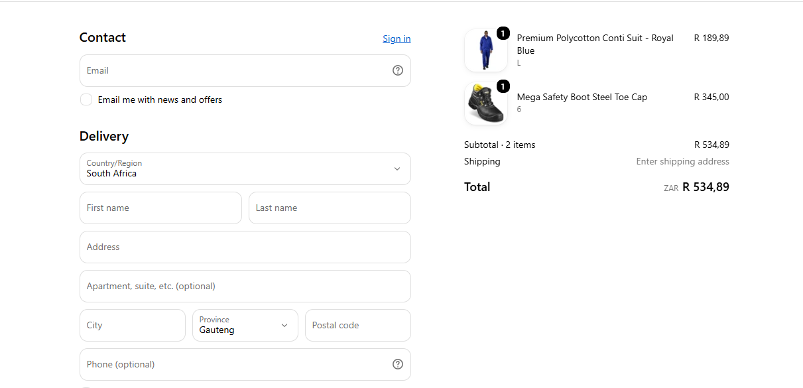
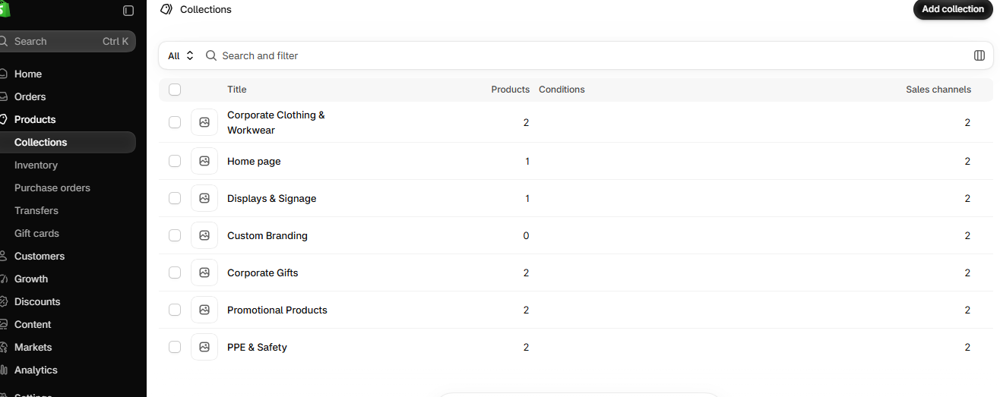
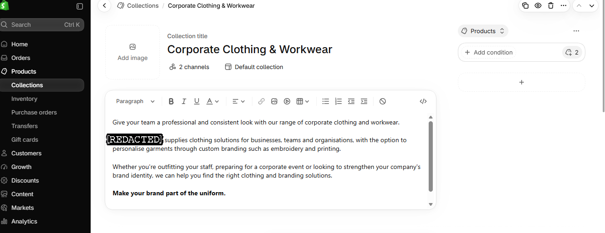
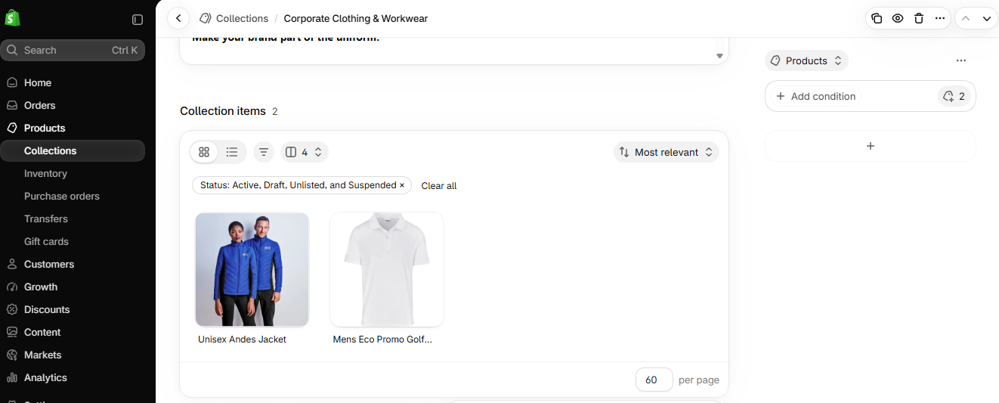

# **Shopify Store Setup & E-Commerce Demonstration**

## **Project Overview**

This project involved creating a Shopify demonstration storefront for a small business with an existing supplier-based product offering, to showcase how its own branded website with an online shop could look, feel and function.

The demonstration was designed to explore the potential customer experience, product presentation, catalogue organisation and e-commerce functionality of a standalone online store.

The business ultimately decided not to proceed with launching the store due to the ongoing platform subscription costs. The demonstration nevertheless provided an opportunity to build and configure a Shopify storefront and showcase practical e-commerce administration skills.

## **Project Objectives**

- Demonstrate how a supplier-based product offering could be presented through the business's own branded online storefront.
- Configure a Shopify store and customise its storefront presentation.
- Organise products into relevant categories and collections.
- Create and manage product listings and product information.
- Configure product options, variants and SKUs.
- Demonstrate product browsing, cart and checkout experiences.
- Review the storefront across desktop and mobile layouts.
- Explore the potential for future supplier product integration.

## **Platform & Tools**

- Shopify
- Shopify Theme Editor
- Shopify Product Administration
- Shopify Collections
- Shopify Navigation and Menus
- Product Variants and Inventory Configuration

## **Store Setup & Configuration**

The demonstration storefront included:

- Homepage and featured content
- About Us page
- Contact page
- Product and service category pages
- Product collections
- Product detail pages
- Product variants and SKU configuration
- Shopping cart
- Checkout interface
- Desktop and mobile storefront layouts

## **Product Catalogue**

Nine products were manually added to the demonstration store across multiple product categories.

The catalogue included examples of:

- Corporate clothing and workwear
- Corporate gifts
- PPE and safety products
- Promotional products
- Displays and signage

Some products were configured with multiple variants, demonstrating the setup and administration of product options, pricing, SKU information and product details within Shopify.

## **Product Administration**

Products were manually added and configured through Shopify's administrative interface.

This included:

- Product titles and descriptions
- Product imagery
- Pricing
- Product categorisation
- Collection organisation
- Product options and variants
- SKU entry
- Inventory settings
- Product listing management

Manual product administration also demonstrated the ability to work with product catalogues and maintain product information directly within an e-commerce platform.

## **Supplier API Integration – Planned Separate Project**

Supplier API integration was part of the broader concept for the store, with the intention of connecting supplier product data to Shopify and reducing the need for ongoing manual product administration.

The integration was not implemented within this demonstration store because it was being developed in a demonstration environment. The intended implementation would require the store to be handed over to the client within their own active Shopify store and account environment, with the appropriate plan and access in place.

Supplier integration is therefore being explored and demonstrated separately as a follow-up portfolio project. **Project 04** will focus on connecting supplier product data to Shopify using a suitable development environment, demonstrating the integration workflow and how product data can be imported and synchronised.

## **Customer Experience**

The storefront was configured to demonstrate a customer-facing shopping experience, including:

- Browsing product categories
- Viewing product collections
- Exploring product detail pages
- Selecting product variants
- Adding products to a cart
- Viewing the checkout interface

The store layout and navigation were also reviewed across desktop and mobile screen sizes.

## **Project Outcome**

The Shopify storefront was developed as a demonstration of how the business could establish its own branded online shopping presence.

Although the business did not proceed with a live launch due to the ongoing Shopify subscription costs, the project provided practical experience in storefront configuration, product administration, catalogue organisation and e-commerce customer experience.

The demonstration also provided a foundation for exploring supplier product integration as a separate technical implementation project.

## **Skills Demonstrated**

- Shopify store setup and administration
- E-commerce storefront configuration
- Product catalogue administration
- Manual product data entry
- Product information management
- Product variants and SKU management
- Collection organisation
- Store navigation configuration
- Product presentation
- Customer shopping journey awareness
- Desktop and mobile storefront review
- Practical problem-solving and platform exploration

## **Project Status**

**Status: Completed – Demonstration Storefront**

The storefront was configured and populated with nine manually added products, including examples with multiple variants. Product listings, collections, navigation, storefront pages and the customer shopping experience were configured within the demonstration environment.

The store was not launched as a live commercial website, as the business decided not to proceed with the ongoing Shopify subscription costs.

Supplier API integration was planned as a subsequent implementation phase and will be demonstrated separately as **Project 04**, using a smaller product selection to showcase the integration process and functionality.

## **Screenshots**

This repository includes selected screenshots documenting:

### 1. Desktop Storefront

#### Homepage

#### About Us

#### Contact Us

#### Product and Service Categories

#### Product Details

#### Shopping Cart and Checkout

### 2. Mobile Storefront

### 3. Shopify Backend and Product Administration

#### Product Dashboard

#### Product Configuration

#### Variants and SKUs

#### Collections

#### Navigation and Pages

